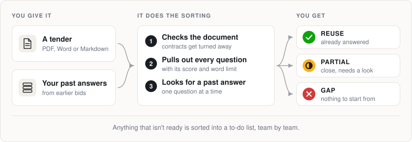
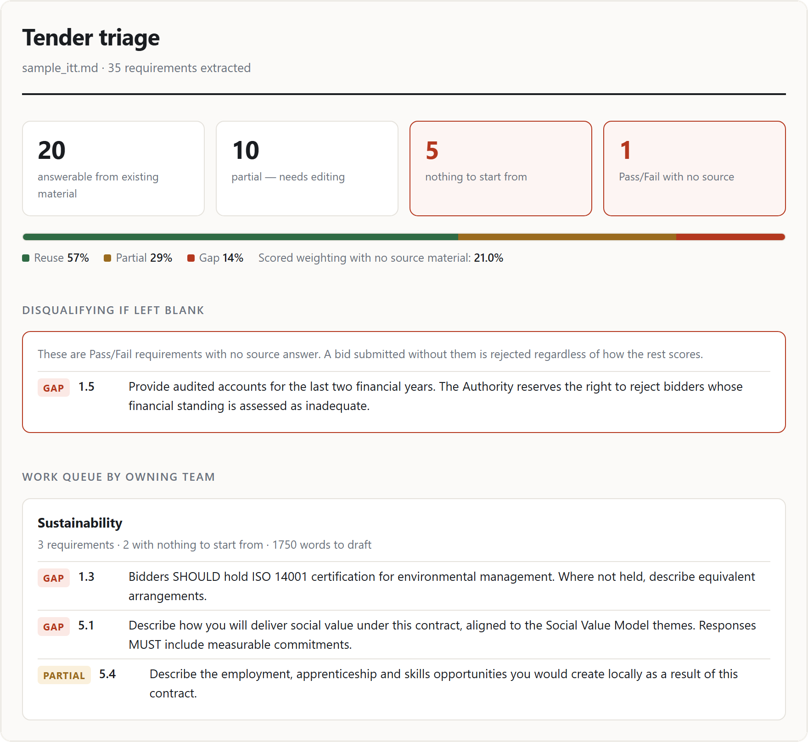
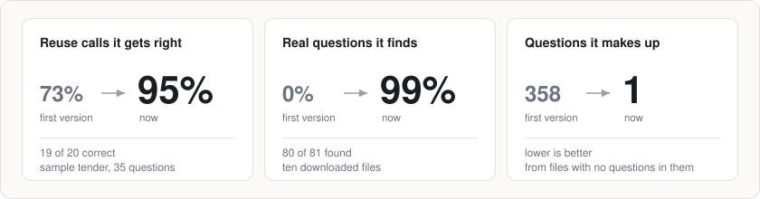

# Tender triage

**Give it a tender and your old answers. It tells you which questions you can
already answer, and which ones you have nothing for.**



## The problem

Bidding for public sector work means answering a lot of questions. An IT
reseller bidding for a four-year council framework answers 30 to 80 scored
questions per submission.

Most of those answers already exist somewhere in an old bid. Writing isn't the
slow part. The slow part is:

- working out which old answer fits which new question
- spotting the questions nobody has ever answered
- finding out on the final weekend that the question worth 10% of the score is
  still blank

This tool does that sorting for you.

## What you get

Every question in the tender comes back with one of three labels:

| Label | What it means | What to do |
|---|---|---|
| 🟢 **REUSE** | You've answered this before | Lift the old answer and edit it |
| 🟡 **PARTIAL** | You have something close | Get a person to look |
| 🔴 **GAP** | Nothing to start from | Someone has to write it |

Anything that isn't a REUSE goes into a to-do list for the team that owns it.
Questions that would get the bid thrown out if left blank go at the very top.

<p>
<picture>
  <source media="(prefers-color-scheme: dark)" srcset="images/report-dark.png">
  
</picture>
</p>

That's the report for the sample tender in this repo. It's made up, but built
like a real one: a council buying laptops, tablets and IT support. Out of 35
questions:

- **20** already have an answer
- **10** have something close
- **5** have nothing, and one of those is pass/fail, so a blank answer sinks the
  whole bid

The full version is in [triage_report.md](triage_report.md).

## Try it

You need Python 3. There is nothing else to install for the sample.

```bash
git clone https://github.com/tomydabest-sys/tender-triage.git
cd tender-triage
python3 tender_triage.py sample_itt.md answer_library.json
python3 report_html.py triage_output.json
```

Then open `triage_report.html` in your browser. On Windows, type `python`
instead of `python3` if that doesn't work.

## Use it on your own tender

```bash
pip install -r requirements.txt     # only needed for PDF and Word files
python3 tender_triage.py your_tender.pdf your_answers.json
```

- **Tender:** `.pdf`, `.docx`, `.md` or `.txt`.
- **Answers:** a JSON file shaped like [answer_library.json](answer_library.json).
  That's a list of answers, each with an `id`, `title`, `text` and `tags`.
- **Results** land in the folder you run it from and replace the last run's.
- **Teams:** questions are sent to teams by keyword. The keyword lists are
  written for IT bids, so edit `CATEGORIES` in `tender_triage.py` for another
  sector.

No API key. No AI model. The same input always gives the same output.

Give it a contract by mistake and it says so, instead of inventing questions:

```
lincs_journey.pdf: CONTRACT — not a question set, nothing to triage.
  Numbered items in this document are contract clauses, not questions.
```

## How it decides

There's no AI here, just careful word matching. Three rules stop it being
fooled:

1. **Common words barely count.** A word like "customer" turns up in most
   answers, so sharing it proves very little.
2. **Specific words must match.** To be called a REUSE, the question and the old
   answer have to share at least two words that belong to a particular topic.
3. **Topics should agree.** A security answer matched to a sustainability
   question loses more than half its score, however similar the wording.

It's cautious on purpose. A wrong REUSE is the expensive mistake: a question
that was never really answered goes out in a bid nobody re-checked. A wrong GAP
only costs someone a read of a question they didn't need to look at.

## How good is it?



It was measured, not guessed. There are two separate tests.

**Test 1: does it match questions to the right answers?**
Checked against 35 hand-labelled questions in the sample tender.

| Measure | Result |
|---|---|
| When it says REUSE, it's right | 95% (19/20) |
| Reusable answers it found | 95% (19/20) |
| Picked the correct old answer | 100% (19/19) |
| Real gaps wrongly called reusable | 0 |

**Test 2: can it read real tender documents?**
Checked against ten files downloaded from Contracts Finder (the UK government's
register of public contracts), each one opened and checked by hand.

| Measure | Result |
|---|---|
| Worked out what kind of document it was | 70% (7/10) |
| Contracts correctly turned away | 2/2 |
| Real questions found | 99% (80/81) |
| Made-up questions from files with no questions in them | 1 |

The first version was much worse. [CALIBRATION.md](CALIBRATION.md) tells that
story: what broke, why, and what fixed it.

### The fine print

- **Test 1 is small.** It's one made-up tender. The labels were written first
  and never edited, but the settings were then tuned against those same 35
  labels. It has not been scored on real tenders.
- **Two of the ten real files were failed downloads.** They are error pages, not
  documents. They're expected to come back as unreadable, and they are two of
  the seven it got right.
- **"Real questions found" compares totals.** It's how many were found against
  how many were counted by hand, not a question-by-question check.
- **The ten real files aren't in this repo.** They belong to other
  organisations, so test 2 can't be re-run from here. Test 1 can:
  `python3 evaluate.py triage_output.json gold_labels.json`
- **The sample tender's weightings add up to 123%, not 100%.** A weighting is
  the share of the marks a question is worth. So the "21% with no source
  material" in the report really means 21 points out of 123.

<details>
<summary>Want to run test 2 on your own documents?</summary>

Put your files in `real/docs/`. List each one in `real/ground_truth.json` with
what it really is and how many questions it has. Then run:

```bash
python3 evaluate_ingest.py real/docs real/ground_truth.json
```

Contracts Finder has a search API at
`https://www.contractsfinder.service.gov.uk/Published/Notices/OCDS/Search`.
Attachment links give a 403 error unless your request sends a browser
`User-Agent` header.

</details>

## What's in the box

| File | What it is |
|---|---|
| `tender_triage.py` | The main tool. Sends questions to teams, matches them to answers, writes the report |
| `ingest.py` | Opens the document, checks it's a question set, pulls out the questions |
| `report_html.py` | Turns the results into a web page |
| `evaluate.py` | Test 1: scores the matching |
| `evaluate_ingest.py` | Test 2: scores the document reading (needs the real files) |
| `sample_itt.md` | The made-up sample tender. ITT stands for Invitation to Tender |
| `answer_library.json` | 18 sample past answers |
| `gold_labels.json` | The 35 hand-written labels for test 1 |
| `real/ground_truth.json` | What each of the ten real files is, and how many questions it has |
| `triage_report.md`, `triage_report.html` | The sample report |
| `CALIBRATION.md` | How the settings were chosen, and what went wrong first |
| `images/` | The pictures on this page |
| `requirements.txt` | The two packages needed for PDF and Word files |
